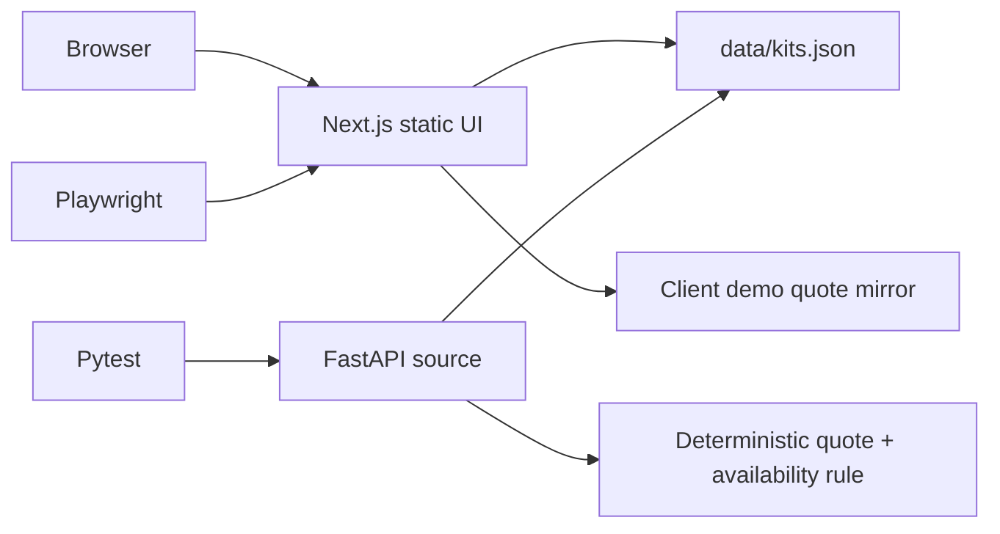
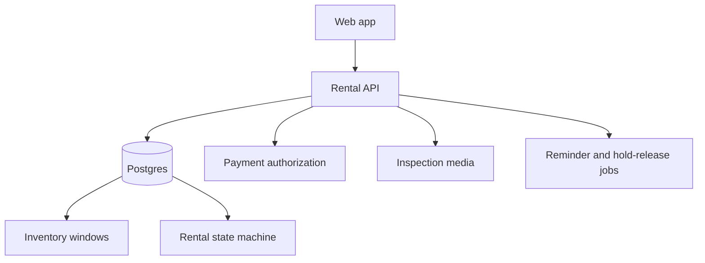

# Architecture

## Demo

GitHub Pages serves only the exported Next.js frontend. It cannot execute FastAPI, so the public demo mirrors the deterministic rule and labels the result as demo-only. CI independently tests the canonical Python operation against the same fixture.

## Quote data paths

1. **Happy:** known kit + 2–21 days + window available → itemized quote.
2. **Nil/wrong type:** strict Pydantic model → HTTP 422; browser controls prevent blank form values.
3. **Empty/unknown kit:** HTTP 404 `kit_not_found`.
4. **Upstream/state conflict:** requested days exceed fixture window → HTTP 409 `inventory_window_unavailable`; UI names remaining days.

## Production boundary

Use an idempotency key for holds and booking. A database exclusion constraint must prevent overlapping `booked` or `turnaround` windows. Payment authorization occurs only after the inventory transaction succeeds; compensation releases inventory on payment failure. Every state transition emits an audit event.

## Observability

Track quote-to-reservation conversion, utilization, unavailable searches, handling minutes, late returns, missing components, damage dollars, payment authorization failures and hold-release latency. Alert on double booking, overdue holds, missing inspection evidence and job backlog.
